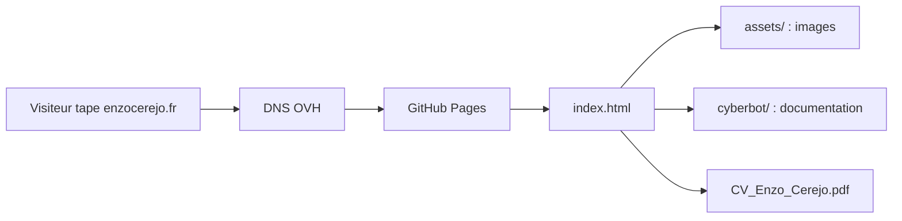

# Portfolio d'Enzo Cerejo · enzocerejo.fr

Ce dépôt contient le site **[enzocerejo.fr](https://enzocerejo.fr)** : le portfolio d'Enzo (BTS CIEL en alternance, réseaux et cybersécurité) et la documentation de son projet de bot Discord **Cyberbot**.

## Par où commencer ?

| Je veux… | J'ouvre… |
|---|---|
| Voir ou modifier la page d'accueil du portfolio | [`index.html`](index.html) |
| Trouver une image ou une police du site (photo, captures, certificats, aperçu réseaux sociaux) | [`assets/`](assets/README.md) |
| Lire la documentation du projet Cyberbot (FR et EN) | [`cyberbot/`](cyberbot/README.md) |
| Télécharger le CV | [`CV_Enzo_Cerejo.pdf`](CV_Enzo_Cerejo.pdf) |
| Comprendre comment tout le projet est relié (carte) | [`graphify-out/`](graphify-out/README.md) |
| Savoir quelles consignes suit Claude | [`CLAUDE.md`](CLAUDE.md) |

## Comprendre le projet en 5 minutes

**Ce que fait le projet.** C'est un site web « statique » : des fichiers posés tels quels sur Internet, sans serveur ni base de données. GitHub Pages (l'hébergement gratuit de GitHub) publie automatiquement le contenu de la branche `main` à l'adresse enzocerejo.fr.

**La carte des dossiers**

| Dossier ou fichier | À quoi il sert, en langage courant |
|---|---|
| `index.html` | La page d'accueil. Elle contient le texte, le style et le script de la page. |
| `assets/` | Les images et les polices utilisées par la page d'accueil, rangées par thème. |
| `cyberbot/` | La documentation du projet Cyberbot, en ligne sur enzocerejo.fr/cyberbot/. |
| `CV_Enzo_Cerejo.pdf` | Le CV téléchargeable. Il reste à la racine pour que son lien public ne change pas. |
| `graphify-out/` | La carte du projet (graphe de connaissances), pour s'y retrouver. Non publiée sur le site. |
| `CNAME` | Le nom de domaine (enzocerejo.fr). GitHub l'exige à la racine. |
| `robots.txt`, `sitemap.xml` | Consignes et plan du site pour Google. Ils doivent être à la racine. |
| `_config.yml` | Réglage de GitHub Pages : la liste des fichiers à ne pas publier. |

**Le trajet d'une visite**

Le nom de domaine (acheté chez OVH) renvoie vers GitHub Pages. GitHub envoie `index.html`, puis le navigateur charge les images de `assets/` quand la page en a besoin.

**Voir le site sur son ordinateur**

1. Sur la page du dépôt, clique sur le bouton vert **Code**, puis **Download ZIP**.
2. Décompresse le fichier ZIP.
3. Double-clique sur `index.html` : il s'ouvre dans ton navigateur. Aucun outil à installer.

**Mettre une modification en ligne** : toute modification fusionnée dans la branche `main` est publiée automatiquement en une à deux minutes.

## Pourquoi c'est rangé comme ça

- **Les adresses publiques ne bougent pas.** Sur un site, l'emplacement d'un fichier devient son adresse web. `index.html`, `cyberbot/` et le CV restent donc à leur place pour ne casser aucun lien déjà partagé.
- **Les fichiers exigés par les outils restent à la racine** : `CNAME`, `robots.txt`, `sitemap.xml`, `_config.yml`.
- **Chaque image est rangée avec le contenu qui l'utilise** : les images de la page d'accueil dans `assets/`, celles de la doc Cyberbot dans `cyberbot/images/`.

## Règles pour la suite

- Un nouveau fichier va dans le dossier qui correspond à son utilité, jamais à la racine.
- Les noms de fichiers sont en minuscules, sans accents ni espaces, et disent ce qu'ils contiennent (`certificat-packet-tracer.jpg`).
- Jamais d'adresse e-mail ni de secret dans le dépôt.

## Petit glossaire

- **GitHub Pages** : service de GitHub qui publie un dépôt comme site web.
- **Site statique** : site fait de fichiers fixes, sans programme qui tourne côté serveur.
- **DNS** : l'annuaire d'Internet, qui relie un nom (enzocerejo.fr) à un serveur.
- **Jekyll** : l'outil que GitHub Pages utilise pour construire le site ; réglé par `_config.yml`.
- **Graphify** : outil qui dessine la carte des liens entre les fichiers du projet.
